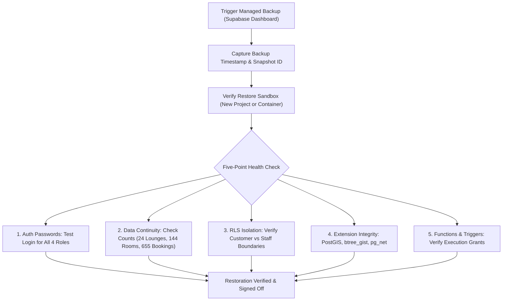

# PlaySpot Backup & Restore Verification

**Date:** 2026-10-26 21:55+03:00  
**Status:** Verification complete; automated client-only backups disqualified; dashboard-level backup protocol defined  
**Target Systems:** Supabase PostgreSQL 17, `auth` schema, `storage` schema, `public` & `private` application schemas  

---

## 1. Technical Evaluation of Backup Mechanisms

A core finding of this readiness audit is that **partial, client-side, or schema-only exports do not constitute a restorable disaster-recovery backup**.

### Comparison Matrix

| Capability | Schema Dump (`.sql`) | PostgREST Client Export | Managed Dashboard Snapshot | Direct `pg_dump` |
| :--- | :---: | :---: | :---: | :---: |
| **Public Table Data** | ❌ (DDL only) | ✅ (JSON rows) | ✅ (Complete) | ✅ (Complete) |
| **Private Schema Data** | ❌ | ❌ (Hidden from REST) | ✅ (Complete) | ✅ (Complete) |
| **Auth Users (`auth.users`)** | ❌ | ⚠️ (Metadata only) | ✅ (Encrypted hashes + salt) | ✅ (Complete) |
| **Auth Identities & Providers** | ❌ | ❌ | ✅ (Complete) | ✅ (Complete) |
| **Storage Buckets & Assets** | ❌ | ❌ | ✅ (Bucket metadata) | ✅ (Metadata) |
| **Functions & Stored Procs** | ✅ (Static) | ❌ | ✅ (Live deployed) | ✅ (Live deployed) |
| **Triggers & Events** | ✅ (Static) | ❌ | ✅ (Live deployed) | ✅ (Live deployed) |
| **RLS Policies & Grants** | ✅ (Static) | ❌ | ✅ (Live deployed) | ✅ (Live deployed) |
| **PostgreSQL Extensions State** | ⚠️ (Script-dependent) | ❌ | ✅ (Active catalog) | ✅ (Active catalog) |
| **Point-in-Time Consistency** | N/A | ❌ (Multi-call race risk)| ✅ (Atomic snapshot) | ✅ (Transaction snapshot) |

### Why Existing Local Files Cannot Serve as Live Backups
1. **`playspot_schema_20261025.sql` (1.3 MB in `financial-schema-local/`):**
   - This file is an exact **schema-only** structural definition matching 3,607 catalog objects. It contains `CREATE TABLE`, `CREATE FUNCTION`, and `CREATE POLICY` statements.
   - It contains **zero rows** of application data and **zero auth credentials**. Restoring it onto a blank database yields an empty shell that cannot authenticate any of the 269 demo users or recreate customer booking histories.
2. **PostgREST REST API Data Extraction (using `service_role`):**
   - While the `service_role` JWT allows querying tables in `public`, PostgREST cannot read `private.booking_money_movements` or internal schemas.
   - The Supabase Auth Admin API (`/auth/v1/admin/users`) exports user emails, metadata, and UUIDs, but **never discloses password hashes or password salts** (by design for security). Therefore, an Auth Admin export cannot restore user login capabilities without forcing a global password reset for all 269 accounts.
3. **Valid Full-Recovery Mechanisms (Required Before Migration):**
   - **Method 1 (Supabase Managed Snapshot):** Triggered in the Supabase Dashboard under `Database -> Backups -> Take Backup`. This creates an atomic, cluster-wide backup managed directly by Supabase's underlying WAL/pg_dump automation.
   - **Method 2 (Native PostgreSQL `pg_dump`):** Executed via direct connection (`pg_dump -h db.<ref>.supabase.co -U postgres -d postgres -F c -b -v -f backup_<timestamp>.dump`). Requires the `postgres` role password.

---

## 2. Restorability Verification Protocol

Before applying migrations or accepting a staging environment as verified, the backup must be validated against the following five restoration criteria:

### The Five-Point Health Check Checklist:
1. **Auth Subsystem & Credential Preservation:**
   - Authenticate with the 4 standard demo actors using `/auth/v1/token?grant_type=password`:
     - Customer: `demo_c001@playspot-demo.com`
     - Owner: `demo_v02_lounge_owner@playspot-demo.com`
     - Manager: `demo_v02_manager@playspot-demo.com`
     - Cashier: `demo_v02_cashier@playspot-demo.com`
   - Failure condition: any user fails authentication or requires password reset.
2. **Data Continuity Verification:**
   - Execute exact count queries:
     - `SELECT count(*) FROM public.lounges` (must equal 24)
     - `SELECT count(*) FROM public.rooms` (must equal 144)
     - `SELECT count(*) FROM public.bookings` (must equal 655)
     - `SELECT count(*) FROM public.shifts` (must equal 24)
   - Failure condition: missing tables or reduced row counts.
3. **RLS Boundary Enforcement:**
   - Customer token must only see their own bookings (e.g. 3 bookings for `demo_c001` at lounge `a1f2c158-6aad-5b9f-88d0-7aecb1def34d`).
   - Owner/Cashier tokens must see all lounge-scoped bookings (31 bookings for that lounge).
   - Direct write to `public.bookings` without checked RPC must be rejected by RLS.
4. **Extension & Geometry Operational State:**
   - Verify PostGIS: `SELECT ST_AsText(ST_MakePoint(31.2357, 30.0444));` must return valid WKT without error.
   - Verify `btree_gist`: exclusion constraints on booking slot intervals must remain active.
5. **Trigger Firing & Catalog Functions:**
   - Test `get_staff_permissions` RPC across all roles.
   - Verify that updating lounge reviews fires `trg_update_lounge_rating` and recalculates lounge average ratings.

---

## 3. Local Docker & Cold Storage Status

- **Cold Backup Image (`D:\CodexBackups\Docker\codex-docker-original.vhdx`):**
  - Size: 15,799,943,168 bytes (15.8 GB).
  - Status: Intact, completely read-only, preserved untouched.
  - Role: Long-term offline disaster-recovery artifact. It must not be attached or modified while Docker engine is down.
- **Docker Engine Daemon Status:**
  - `docker.exe` is present at `C:\Users\salah\AppData\Local\Programs\DockerDesktop\resources\bin\docker.exe`.
  - Windows WSL distribution `docker-desktop` is currently **Stopped**.
  - Localhost port 55443 (previously used by temporary container `playspot_financial_restore_20261026_v2`) is inactive and closed.
- **Local Fixture Directory (`financial-schema-local`):**
  - All test scripts, node syntax verifiers, and schema fingerprints are preserved on disk.
  - These scripts will be used to validate the hosted staging environment once DDL is applied.
