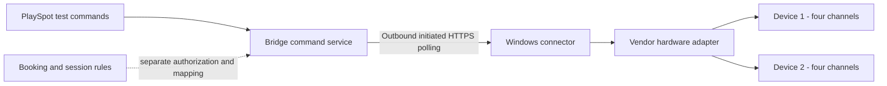

# PlaySpot integration implementation plan

21 October 2026. Everything remains OFF by default. This document authorizes
neither database deployment nor physical-device activity.

## Boundaries and authority

The diagram shows logical command delivery; Windows initiates cloud connections.
A future MTTL listener accepts device-initiated TCP only on the isolated LAN.
No cloud-to-LAN port forward. The delivered runtime implements only in-process
mock equivalents of these boxes. It starts no Windows service or network port.

Keep three distinct adapters: vendor cloud API, vendor local management system,
and hardware-specific transport. A hardware ACK must never be interpreted as
successful reservation, payment or session finalization. No hardware adapter
may write booking, payment, shift or cashier tables. Session start permission
does not imply permission to cut mains power. Ending a PC session requires
graceful OS/vendor handling; power removal needs a separate hardware policy.

Record one owner per operation: availability, future reservation, session,
pricing and settlement. Hybrid must have an explicit matrix, not two concurrent
writers. Use provider + lounge + installation + resource/channel identities.
One physical resource represented by multiple installations/integrations needs
a reviewed exclusive authority rule; per-integration uniqueness alone is not
global collision prevention.

## Stage A — complete preview review (this change)

Implemented: default-off questionnaire, stable draft step IDs/legacy migration,
generated conditional catalog, sanitization of hidden values, AR/EN tests,
planner fixes, reference simulator safety fixes, review-only composite tenant
FKs and isolated SQL checks, two-device mock lab and Arabic operator guide.

No production migration, server survey persistence, agent binary, vendor adapter
or physical integration was added. Existing onboarding RPC/KYC submission
payloads remain the data authority. Review the original PRs and the follow-up
branches together, and keep the originals draft until the fixes are adopted.

## Stage B — establish a real vendor contract

Choose one authorized lounge-management supplier. Obtain official documentation,
test environment and written integration scopes. Verify API authentication,
version support, future atomic reservation, status lookup by operation ID,
cancel semantics, session commands, event signatures, rate limits and pricing
authority. A closed/read-only vendor gets manual confirmation or partitioned
inventory; it cannot be marked instant-bookable from a questionnaire.

Choose and document a supported Windows/architecture baseline after checking
vendor dependencies and current TLS support; no minimum Windows version is
certified by this mock. Document signed update/rollback and support policy.

## Stage C — isolated server schema and security

Use this repository as migration source of truth. After explicit environment
approval, compare the intended target schema to fixtures; generate a new CLI
migration and rehearse against a disposable full Supabase environment. Never
apply docs/bridge/proposed_schema.sql directly to production or demo.

The proposal now protects mappings through composite tenant FKs, including
parent reparenting. Its public.rooms unique constraint is only a proposal:
evaluate duplicate-index cost, lock time and existing constraints before
promotion. Reapplying the proposal deliberately fails on existing objects rather
than silently accepting schema drift. RLS enabled + revoked client grants gives
deny-by-default; it does not authorize service-role requests, which bypass RLS.

Still required before production:

1. Versioned assessment persistence, size limits, safe ownership and retention.
2. Per-operation authority/capability/consent records and an enforced activation
   transition machine; align proposal state names with API/UI.
3. Expiring one-use pairing challenges, installation keys, token rotation,
   durable revocation, minimum agent version, owner and central operator checks.
4. Typed mapping and command resource references, tenant FKs, immutable payload
   digest, actor, expected version, absolute deadline, lease owner/fencing token,
   attempt limits, bounded errors and stable idempotency receipts.
5. Distinct accepted/acknowledged/observed-confirmed/unknown/compensation states;
   reject illegal transitions and payload mutation under an existing command ID.
6. Immutable server audit ledger, including approvals/revocations/denials, with
   narrowly granted append access and explicit retention. The proposal currently
   has no audit table; mock audit is not a replacement.
7. Signed/deduplicated event inbox, source cursor/order/origin, safe reconciliation
   and dead-letter/operator review records.
8. Server APIs must resolve canonical active lounge permissions on each operation;
   never trust editable user metadata, a client tenant ID or a valid token alone.

The synthetic SQL fixture proves eight stated constraints/grants checks only.
It does not prove full deployed schema, PostgREST exposure, service role tenant
checks, Supabase Auth, full migration compatibility or two-connection races.
Run native PostgreSQL concurrent parent-change/insert races and real test-user
RLS cases in an isolated environment before approving the migration.

## Stage D — command service and Windows connector

Build a cloud service that authenticates the human requester, authorizes tenant,
operation and approved capability, validates a typed payload and atomically
inserts a command/audit receipt. Workers claim leases with fencing tokens. Agents
fetch over outbound TLS with installation-specific scope; signed envelopes bind
tenant, installation, adapter, device, payload hash, sequence, expiry and command
ID. Validate signature, rotation/revocation, expiry and scope before execution.
No arbitrary scripts, shell commands or SQL accepted from cloud payloads.

Persist receipt and intended action before any external effect. Recover a crash
between send and receipt as UNKNOWN, not failed. Keep a durable local journal
protected to the service account and send sanitized audit to the server. Do not
promise exactly-once physical effects: a non-transactional vendor cannot guarantee
them across crash boundaries. Query state and require operator resolution where
causality cannot be established. Never silently clear unresolved commands.

Use Windows protected storage for installation keys, never Supabase service_role
or platform/admin database credentials. Central secrets stay server-side; any
necessary local vendor credential must have minimal scope, encrypted storage,
rotation and explicit disclosure. Signed installer/update packages, least
privilege service account, safe log ACLs, uninstaller and narrow firewall rules
must be validated. No public local HTTP power endpoints.

## Stage E — hardware adapter, still isolated

Start from the delivered mock contract. Implement bounded pure parsers first:
partial/concatenated frames, null padding, malformed/oversized bootinfo/getinfo,
channels outside 1–4, duplicate channels, unsupported firmware and identifier
changes. Test recorded/synthetic bytes without sockets. No need for flashing.

Only after qualified electrical clearance and explicit owner permission: create
a LAN-only listener, enroll expected device identity locally, record actual
firmware evidence, and begin read-only inspection with no attached loads. A
MAC/client ID is forgeable; isolate network and quarantine duplicate identities.
Serialize one in-flight command per device, preserve independent queues, fence
old sockets and correlate ACKs to connection generation. Use known/on/off/unknown
states with freshness timestamps; initial and stale states must be UNKNOWN.
Readback after a response and refuse blind replay after a timeout/reconnect.

Any outlet switching or load test needs separate explicit approval and qualified
electrical guidance. Never automatically toggle all outlets at startup, update,
revoke, offline recovery or uninstall. Do not copy the reference analytics or
optimistic state semantics into the PlaySpot adapter.

## Stage F — booking/session integrity

Use a saga with persisted intent and compensation. Reserve remote capacity
atomically first, finalize through existing authoritative PlaySpot hold/checkout
RPCs, link receipts and only then show confirmed. If local finalization fails,
cancel remote capacity; ambiguous compensation blocks the slot for review.
Coordinate payment authorization/capture/refund with current financial rules.
External payload cannot rewrite prices or settle funds.

PlaySpot exclusion/hold locks protect PlaySpot capacity only. The reference
simulator's synchronous map collision tests are not cross-vendor concurrency
proof. Test two truly concurrent callers, vendor-native sales vs PlaySpot,
response loss after remote success, finalization rollback, ambiguous cancel,
event echo/duplicates/out-of-order updates, revoked/expired installation leases,
offline/restart recovery, adjacent/cross-midnight/DST intervals and partial
refund/capture failures. Unsupported extension must remain rejected until its
future capacity is checked atomically.

Existing cashier offline writer authority stays distinct. Offline hardware
availability is UNKNOWN, never free inventory. No automatic replay of old
reservation/session/power commands on reconnect. Native PlaySpot lounges must
continue to work with no integration rows and all new flags false.

## Stage G — release gates

Provide full CI results, isolated schema/RLS/concurrency evidence, signed Windows
installation/uninstallation evidence, actual AR/EN screenshots, compatibility
matrix with exact firmware/revision, and operator rollback/reconciliation guide.
Pilot read-only/shadow mode for one lounge and one vendor. Review mismatch rates
and unknowns before capability-by-capability approval. Require recorded lounge
consent and central integration approval; expose suspend/revoke and kill switch.
Obtain owner approval before merge, deployment, or live hardware operations.

No step in this plan is permission to modify production/demo Supabase, merge the
PRs, deploy production, open public LAN ports or energize/control physical units.
